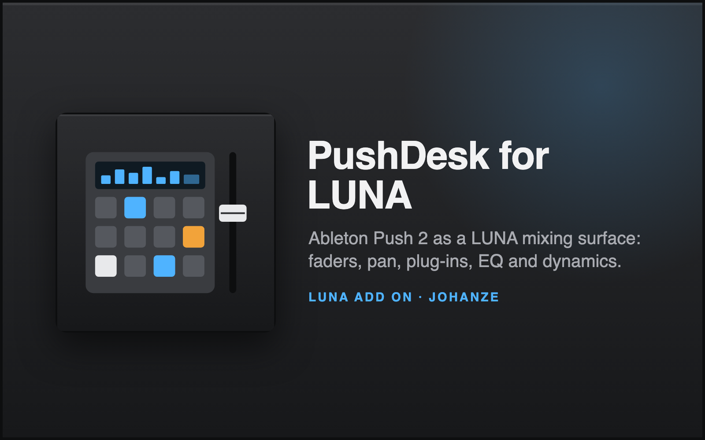

# PushDesk for LUNA



Use an **Ableton Push 2** as a mixing control surface in **UA LUNA**: the encoders, touch strip,
pads and buttons drive LUNA's faders, pan, plugins and channel-strip EQ and dynamics, the way
Push does in Live and an Avid S1 does in Pro Tools. With the optional helper, the Push's own
screen shows what each encoder is doing.

Needs LUNA 3.1.2 or later on macOS, and a Push 2.

## Install

1. **The Add On:** download `pushdesk-luna.lunaaddon` from the
   [latest release](https://github.com/johanze-ops/pushdesk-luna/releases/latest) and
   double-click it. In LUNA, open **Add Ons > Editors > PushDesk for LUNA**.
2. **The Push screen (optional but recommended):** paste this into Terminal (Applications >
   Utilities) once:

   ```
   curl -fsSL https://github.com/johanze-ops/pushdesk-luna/releases/latest/download/install-helper.sh | bash
   ```

   The PushDesk panel shows the same line, with a Copy button, until the helper is running.
3. **In LUNA's MIDI settings**, take the **Ableton Push 2** ports out of *All*, so the pads
   and buttons don't play notes into your instrument tracks. PushDesk listens to the Push
   directly, so it still hears it.

The panel can sit under the Timeline (the editor panel), in the side browser, or in a floating
window that stays visible on the Mixer too. Use the host switch in its header to move it. LUNA
reopens it with the session.

## The controls

| Push | In LUNA |
|---|---|
| **Encoders 1–8** | the selected knobset across 8 tracks (or 8 plugin parameters). Touch an encoder to grab it: one undo step per move, and automation writes properly. **Shift** = fine. |
| **Row above the screen** | knobsets: **a** FADER · **b** PAN · **d** PLUG · **e** EQ · **f** DYN |
| **Row below the screen** | the selected track's plugins (channel strip, tape, then inserts). Press one to control it and open its window. |
| **◀ ▶ (Page)** | the next or previous 8 tracks, or 8 parameters in a plugin |
| **↑** | in a plugin: your favourites ↔ the plugin's own order |
| **↓** | FADER ↔ the last knobset |
| **Touch strip** | the selected track's fader |
| **Pads, bottom 4 rows** | select · mute · solo · record arm, for the 8 tracks on the encoders |
| **Delete** | lock the motor fader to its track (see below) |

- **Selecting a track in LUNA** pages the Push to it. In PLUG, EQ and DYN the plugin control
  follows: the same plugin (and page) on the new track if it has one, else the one in the same
  place in the row.
- **Opening a plugin window** in LUNA puts it on the encoders.
- **EQ / DYN** go straight to the selected track's channel strip (e.g. API Vision): EQ to its
  EQ page, DYN to the compressor, and DYN again to the gate.
- **Several tracks selected:** moving one of them (encoder, touch strip or motor fader) moves
  them all by the same number of dB, as Logic does.

## Favourites

`favourites/<plugin name>.txt` puts a plugin's parameters in your order, 8 per Push page,
named as LUNA shows them. Everything else follows. `#` starts a comment.

```
@section EQ                  # where the EQ button lands (a section starts a fresh page)
@if EQ Select = 560L         # follow a switch on the plugin
560 31Hz
...
@else
550 LF Freq
...
@end
@section DYN                 # where DYN lands; a second @section DYN is "DYN again"
225 Thresh
```

Files for the **API Vision Channel Strip** and the **UADx SSL E Channel Strip** are included.

## Motor fader (optional)

A one-fader motorised controller that speaks Mackie single-fader MIDI (14-bit pitch bend on
channel 1 both ways, touch on note 104), named **PushDesk Fader**, follows the selected track:
touch to take over, release to hand back, Delete on the Push to lock it to a track. Its solo
(note 8), mute (16) and utility (54, motors off/on) buttons work too.

## The helper

The Push screen is driven over USB, which a LUNA Add On can't reach, so a small helper app
draws it: `~/Library/Application Support/PushDesk for LUNA/pushdesk-luna-helper` (Swift, Apple
frameworks only).

- It starts at login, does nothing until LUNA runs, and only uses the Push screen while
  PushDesk is talking to it. It hands the screen back after 10 seconds of quiet or when LUNA
  quits, so Ableton Live can use the Push as usual.
- It listens only on `127.0.0.1:47829`, and sends nothing anywhere.
- Log: `~/Library/Logs/PushDesk for LUNA/helper.log`.
- Remove it with:

  ```
  curl -fsSL https://github.com/johanze-ops/pushdesk-luna/releases/latest/download/uninstall-helper.sh | bash
  ```

Only one app can use the Push screen at a time: quit Live first if it has it.

## Building from source

- **Add On:** `npm install && npm test` (tests run against the SDK's mock engine). Package
  it with `scripts/pack.sh`.
- **Helper:** `helper/build.sh` builds universal binaries into `helper/build/`.
  `PUSHDESK_HELPER_BINARY=helper/build/pushdesk-luna-helper helper/install-helper.sh`
  installs your build.

## Licence

MIT, see [LICENSE](LICENSE). `vendor/luna.global.js` is Universal Audio's LUNA Builder SDK,
under the Apache License 2.0 (`vendor/LICENSE-luna-builder-sdk`,
`vendor/NOTICE-luna-builder-sdk`). Not affiliated with Ableton or Universal Audio. Push is a
trademark of Ableton, LUNA of Universal Audio.
